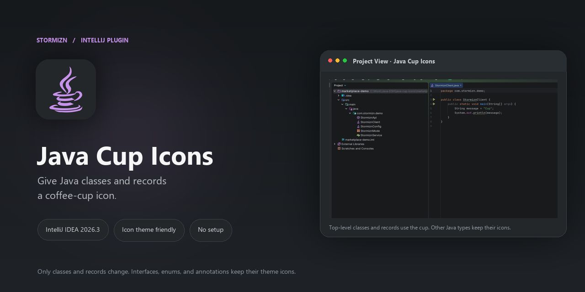

# Java Cup Icons



An IntelliJ IDEA 2026.3 plugin that gives top-level Java **classes** and **records** a coffee-cup
icon in the Project View and editor tabs.

Interfaces, enums, and annotation types keep the icons supplied by your active theme. The plugin
was built and tested with **Atom Material Icons 210.0.2**, and works alongside it without modifying
any theme files.

## Behavior

| Java declaration | Result |
| --- | --- |
| Top-level `class` | Coffee-cup icon |
| Top-level `record` | Coffee-cup icon |
| `interface` | Unchanged theme icon |
| `enum` | Unchanged theme icon |
| `@interface` | Unchanged theme icon |
| Nested class inside an interface | Unchanged theme icon |

The 16 px and 32 px resources are direct downscales of the supplied artwork with the dark
background removed. At 16 px, the smallest details naturally compress to the Project View icon
size.

## Source

[github.com/stormizn/Java-Cup-Icons](https://github.com/stormizn/Java-Cup-Icons)

## Install

### From JetBrains Marketplace

After the plugin is published, search for **Java Cup Icons** in **Settings | Plugins** and click
**Install**.

### From disk

1. Build or download `java-cup-icons-1.0.3.zip`.
2. Open **Settings | Plugins**.
3. Use the gear menu and choose **Install Plugin from Disk...**.
4. Select the ZIP and restart the IDE.

No configuration is required.

## Compatibility

- IntelliJ IDEA **2026.3** (build 263)
- Java plugin (bundled)
- Atom Material Icons is optional

## Privacy

The plugin has no telemetry, network calls, settings, or background services. It only answers the
IDE's icon-provider requests for Java PSI elements and files.

## Build from source

Requirements: JDK 25 and the included Gradle wrapper.

```powershell
.\gradlew.bat buildPlugin
```

The installable ZIP is written to `build/distributions/java-cup-icons-1.0.3.zip`.

The build uses the locally installed IntelliJ IDEA at:

```text
C:\Users\Ayush\AppData\Local\Programs\IntelliJ IDEA Ultimate
```

Override it with `-PplatformLocalPath=...`:

```powershell
.\gradlew.bat -PplatformLocalPath="C:\Path\To\IntelliJ IDEA Ultimate" buildPlugin
```

## Marketplace

The Marketplace-ready listing copy, screenshots, icon, and review checklist are in
[`docs/marketplace`](docs/marketplace). The full publishing walkthrough is in
[`PUBLISHING.md`](PUBLISHING.md).

## Project layout

```text
src/main/java/com/stormizn/cupicons/   icon providers and Java type detection
src/main/resources/icons/            16 px and 32 px plugin icons
src/main/resources/META-INF/         plugin descriptor and plugin logo
docs/marketplace/                    Marketplace copy and media
```

## License

[MIT](LICENSE)
